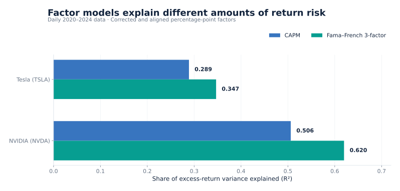
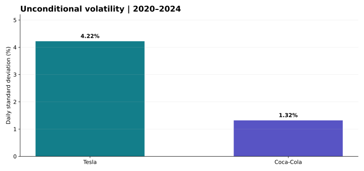
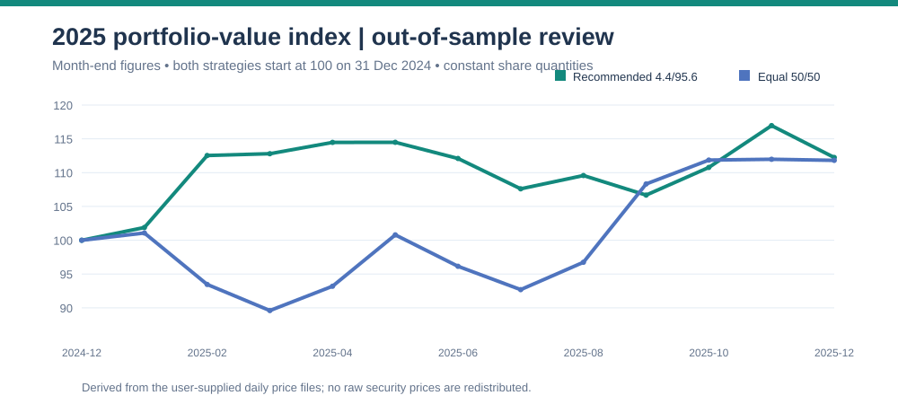

# Financial Econometrics — RMIT University
**Master of Finance · ECON1195 · Individual quantitative finance projects**

An employer-oriented portfolio of financial-econometric studies: from returns and market-efficiency diagnostics to quantitative modelling and investment decisions. Projects focus on the **financial question, data limitations, methodological choices and independently supportable results**.

## Quantitative finance case studies

| Assessment | Research question | Techniques and findings |
|---|---|---|
| **[01 · Tesla vs NVIDIA — Market Efficiency and Factor Risk](assessment-1-tesla-nvidia/README.md)** | Can equity-return dependence and systematic factor exposures be detected? | Descriptive statistics, Ljung–Box, variance-ratio tests, CAPM and Fama–French FF3. Corrected FF3 R²: **34.7% TSLA** and **62.0% NVDA**. |
| **[02 · Tesla vs Coca-Cola — ARMA/GARCH Modelling](assessment-2-tesla-coca-cola/README.md)** | How predictable are daily returns and how does volatility react to shocks? | ARMA specification, ACF/PACF, ARCH-LM, GARCH and GJR-GARCH. Submitted preferred models: **TSLA ARMA(1,1)/GARCH(1,1)** and **KO ARMA(6,2)/GJR-GARCH(1,1)**. |
| **[03 · Tesla & Coca-Cola — Investment Committee Portfolio](assessment-3-portfolio-investment-analysis/README.md)** | How should an A$1.5m two-stock mandate be allocated before 2025? | Long-only minimum variance, GARCH/VaR (report-based), VAR/Granger (report-based), **2025 out-of-sample price-only evaluation**. Independently verified weights: **4.4% TSLA / 95.6% KO**. |

### Assessment 1 · Equity factor analysis

[View the investment-factor case study](assessment-1-tesla-nvidia/README.md) · [Data audit](assessment-1-tesla-nvidia/docs/model-audit.md)

### Assessment 2 · Return and volatility models

[View the ARMA/GARCH case study](assessment-2-tesla-coca-cola/README.md) · [Model-selection audit](assessment-2-tesla-coca-cola/docs/validation-and-audit.md)

### Assessment 3 · Investment portfolio and performance evaluation

[View the investment committee case study](assessment-3-portfolio-investment-analysis/README.md) · [Model and report-variant audit](assessment-3-portfolio-investment-analysis/docs/model-audit-and-limitations.md)

> **Important:** Assessment 1 used Tesla/NVIDIA, while Assessments 2 and 3 used Tesla/Coca-Cola despite the briefs requesting the same companies. The Assessment 3 source versions also disagree on conditional VaR and some ARIMA/VAR specifications. These discrepancies are documented, not hidden. The final original assessment restricted AI use to R-code debugging; this is a separately identified **post-submission AI-assisted portfolio reconstruction**, not the work submitted for marking.

## Structure

Each case study has its own executive findings, reproducibility guide, source-code reconstruction, figures, aggregate result tables, model limitations and rights notice. The original student submissions and third-party raw exports are **not distributed** in this GitHub-facing archive.

## Responsible publication

The original university submission and proprietary source data remain excluded. Published artefacts use derived aggregate results and independently drawn charts. This is a **portfolio-format, AI-assisted reconstruction** based on an individual RMIT assessment, not an RMIT-endorsed research product or live investment recommendation. Raw data remain local and their original licences apply.

[GitHub profile](https://github.com/Pratham8901) · [Corporate Financial Management portfolio](https://github.com/Pratham8901/corporate-financial-management-project-valuation)
