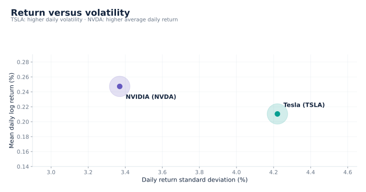
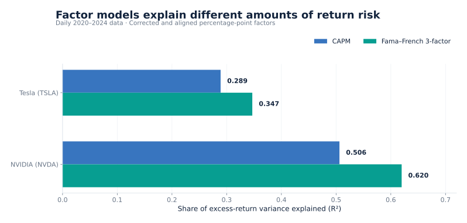
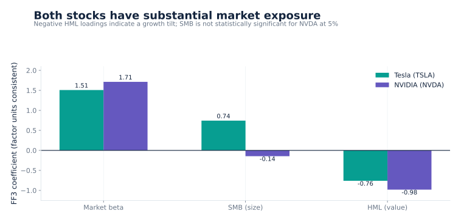
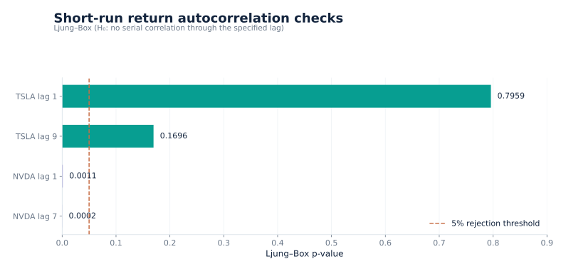

# Case Study 01 — Tesla vs NVIDIA: Market Efficiency and Factor Risk

**RMIT University · Master of Finance · Financial Econometrics (ECON1195)**  
**Individual academic analysis · 2020–2024 trading data · Portfolio reconstruction**

[← Subject portfolio](../README.md) · [Methods](docs/methodology.md) · [Model audit](docs/model-audit.md) · [Data policy](data/README.md)

> **Investment-research question:** How do two high-growth US stocks differ in their daily-return risk, evidence of serial correlation and exposure to market, size and value factors?

## Executive research findings

| Finding | Tesla (TSLA) | NVIDIA (NVDA) |
|---|---:|---:|
| Mean daily log return | **0.210%** | **0.247%** |
| Daily return volatility | **4.221%** | **3.370%** |
| CAPM market beta | **1.647** | **1.740** |
| CAPM R² | **0.289** | **0.506** |
| Fama–French R² | **0.347** | **0.620** |
| Ljung–Box, lag 1 | p = **0.796** | p = **0.001** |
| Original Chow–Denning joint test | **Not rejected** | **Rejected** |

**Takeaway:** Tesla displayed more daily return volatility, while NVIDIA had a stronger average daily return and more of its historical return variation explained by standard equity factors. The original random-walk test results were consistent with little detectable return autocorrelation for Tesla but evidence of autocorrelation for NVIDIA. This is **not** a claim of an exploitable arbitrage or a future-return forecast.



## Which factor model explains more?



The correctly specified Fama–French regressions increased the historical variance explained from **28.9% to 34.7%** for Tesla, and from **50.6% to 62.0%** for NVIDIA. Both stocks had market beta substantially above 1, and negative HML exposures, consistent with a growth style. NVIDIA's size exposure was not significant at the 5% threshold in the consistent-unit regression.



## Market-efficiency diagnostics



At the 5% threshold, the independently reproduced Ljung–Box tests do **not** reject serial-correlation restrictions for Tesla at lags 1 or 9, while rejecting at both reported NVIDIA lags. The original Chow–Denning and Lo–MacKinlay tests are described separately in the [methodology](docs/methodology.md) and labelled as **not independently rerun**. Market efficiency is a much broader proposition than one time-series diagnostic.

## Model audit — why the results differ from the original report

The originally submitted R code mixed **decimal stock returns** with **percentage-point Fama–French factors**. It produced different R² statistics from a unit-consistent specification. The portfolio companion explicitly fixes units and matches trading dates. [Full transparent reconciliation](docs/model-audit.md).

## Project structure and reproducibility

| File/folder | Purpose |
|---|---|
| [scripts/run_analysis.R](scripts/run_analysis.R) | Corrected R code: returns, matched factors, diagnostics and regressions |
| [results](results) | Aggregate independently checked model estimates and test output |
| [figures](figures) | Static SVG visualisations made from reported/verified aggregates |
| [docs/methodology.md](docs/methodology.md) | Assumptions, formulas, inference limits and sources |
| [docs/model-audit.md](docs/model-audit.md) | Original submission versus corrected factor scaling |
| [data/README.md](data/README.md) | Instructions for providing raw data locally without redistributing them |

To rerun from the assessment directory, provide the three private CSVs and use:

```bash
Rscript scripts/run_analysis.R
```

Requires R and the `moments` package (the `vrtest` package is optional for variance-ratio diagnostics). **R was not available when preparing this repository**; the static statistics were independently verified in Python against the input CSVs. See the [audit notes](docs/model-audit.md) for verification boundaries.

## Skills demonstrated to employers

**Financial analysis:** equity-return comparison, systematic risk, factor investing, efficient-market diagnostics.  
**Econometrics:** regression specification, hypothesis testing, R² interpretation, factor-model choice.  
**Technical:** R, data cleaning, mixed-date parsing, factor data alignment, reproducible reporting.  
**Professional judgement:** documenting statistical uncertainty and discovering / correcting unit-related model discrepancies.

*AI-assisted portfolio reconstruction of an individual student assessment; original graded submission is not included. Historical educational analysis, not investment advice.*
