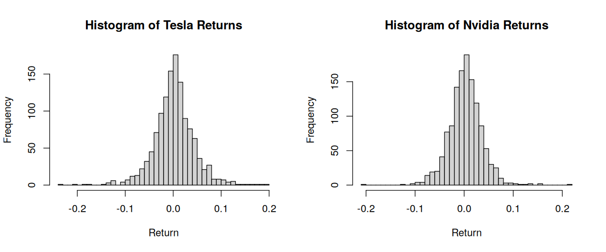

# Tesla and NVIDIA equity returns

**Individual R analysis · Pratham Kurele · RMIT Financial Econometrics · Assessment 1**

I compared 1,257 daily log returns for each company from January 2020 through December 2024. NVIDIA had the higher average daily return in the sample, while Tesla had the wider day-to-day price swings.

| From Table 1 of my report | Tesla | NVIDIA |
| --- | ---: | ---: |
| Mean daily log return | 0.210% | 0.247% |
| Daily standard deviation | 4.221% | 3.370% |

I used variance-ratio tests to check whether past returns contained information about future returns. The joint Chow–Denning test did not reject a random walk for Tesla. It rejected one for NVIDIA at the horizons I tested. I also compared a market-only model with the Fama–French three-factor model to examine market, size and value exposures.

*From my individual report, “Testing Market Efficiency and Factor Exposure: A Comparative Study of Tesla, Inc. and NVIDIA Corporation,” Table 1, Figure 2 and Table 4.*

[Financial econometrics projects](../README.md)
