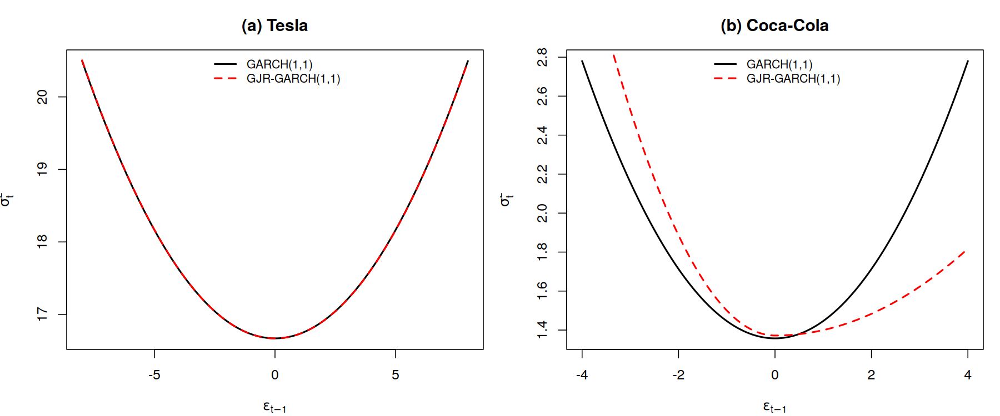

# How Tesla and Coca-Cola respond to shocks

**Individual R analysis · Pratham Kurele · RMIT Financial Econometrics · Assessment 2**

I tested whether a price drop and an equally large rise had the same effect on the next day’s volatility. In the January 2020 to December 2024 sample, the estimated effects were nearly symmetric for Tesla. For Coca-Cola, a negative shock raised the forecast variance more than a positive shock of the same size.

| Specification selected in the report | Tesla | Coca-Cola |
| --- | --- | --- |
| Mean return | ARMA(1,1) | ARMA(6,2) |
| Conditional volatility | GARCH(1,1) | GJR-GARCH(1,1) |

I checked the fitted models for volatility clustering left in their residuals. Low-order ARCH models left significant clustering in both stocks. Adding lagged conditional variance addressed it, and Coca-Cola’s asymmetric model also captured the larger response to negative news.

*From my report, “Modelling the Returns and Volatility of Tesla, Inc. and The Coca-Cola Company,” Sections 2 and 3 and Figure 4.*

[Financial econometrics projects](../README.md)
