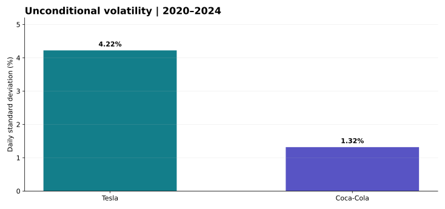
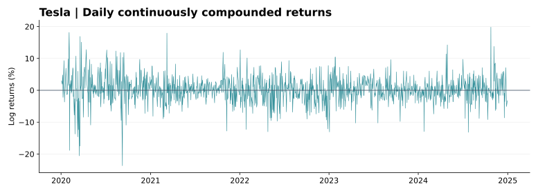
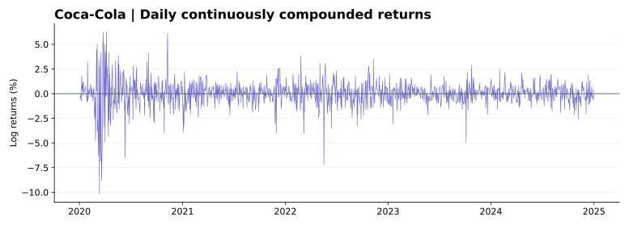
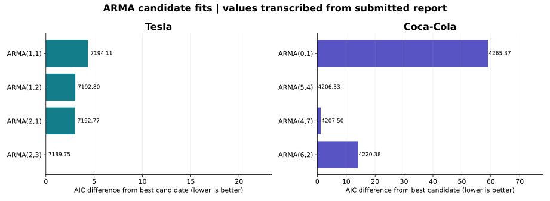
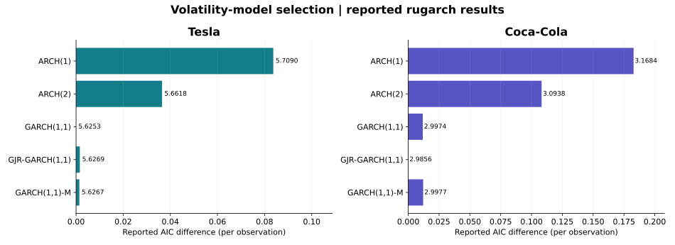

# Assessment 2 · Time-Series Forecasting & Equity Volatility

**Financial Econometrics · ECON1195 · RMIT University · Individual coursework-based case study**  
**Stocks:** Tesla (NASDAQ: TSLA) and The Coca-Cola Company (NYSE: KO)  
**Historical sample:** 2 January 2020 – 31 December 2024 (1,257 daily log returns for each stock)

[← Financial Econometrics portfolio](../README.md) · [Reproduction guide](data/README.md) · [Model audit](docs/validation-and-audit.md)

> **Decision question:** Which time-series models are appropriate for the **conditional mean** and **time-varying risk** of a high-volatility growth stock versus a defensive consumer-staples company?
>
> This page is a **new, AI-assisted portfolio presentation of the completed individual report**. Historical reported ARMA/GARCH fit values are labelled as *student-submitted results* and have not yet been re-estimated with the native R packages in this environment. The original report and raw market-data exports are intentionally not republished.

## Key findings

| Measure | Tesla (TSLA) | Coca-Cola (KO) |
|---|---:|---:|
| Mean daily log return, independently checked | **0.2104%** | **0.0099%** |
| Daily standard deviation, independently checked | **4.2208%** | **1.3179%** |
| Ljung–Box test on returns | Lag 9: **p = 0.170** | Lag 2: **p = 0.0045** |
| Submitted preferred mean model | **ARMA(1,1)** | **ARMA(6,2)** |
| Submitted preferred volatility model | **GARCH(1,1)** | **GJR-GARCH(1,1)** |
| Submitted volatility persistence | **0.970** | **0.979** |
| Key analytical insight | Near-unpredictable mean; persistent, approximately symmetric conditional risk | Evidence of return dependence and stronger negative-news volatility response |

*The significance and model-selection rows reproduce the submitted report; return moments and the Ljung–Box p-values were independently checked against the supplied CSVs. None of these are current stock forecasts.*

## Return data and unconditional risk



Tesla was approximately **3.20×** as volatile as Coca-Cola over the sample, while the correlation between their daily returns was only **0.1713**. These are descriptive, historical measures—not evidence of a stable correlation or a superior risk-adjusted future return.





## 1 · Modelling the conditional mean

The analysis starts with return stationarity and the **ACF/PACF** and Ljung–Box diagnostics, then evaluates four candidate ARIMA(p,0,q) models per stock. Because returns are stationary, **d = 0**, making these ARMA models.



The submitted report selects **Tesla ARMA(1,1)** because of low complexity and residual adequacy. Its AR and MA coefficients almost cancel, so a constant-mean benchmark would be a useful further test. For Coca-Cola, the report selects **ARMA(6,2)**, despite **ARMA(5,4) winning AIC, AICc and BIC** among the reported candidates. This is a genuine complexity-versus-fit tradeoff, *not* a claim that ARMA(6,2) is the statistical winner under those criteria.

[Detailed model-selection considerations](docs/validation-and-audit.md)

## 2 · Modelling conditional variance

ARCH-LM tests on fitted mean-model residuals indicate conditional heteroskedasticity in both stocks (the student reported **LM 73.10 for Tesla** and **397.53 for Coca-Cola**, 12 lags). Five conditional-variance specifications are compared: ARCH(1), ARCH(2), GARCH(1,1), GJR-GARCH(1,1), and GARCH-in-mean.



The student report recommends **symmetric GARCH(1,1)** for Tesla and **asymmetric GJR-GARCH(1,1)** for Coca-Cola. The latter is supported by a reported positive leverage/asymmetry coefficient of **0.1007**. Although the in-sample fits are useful illustrations of model selection, risk estimates warrant heavy-tail specifications, stability checks and out-of-sample testing before practical deployment.

## What this demonstrates to a financial employer

- Designing tests to distinguish **return predictability** from **conditional volatility**.
- Selecting and comparing **ARMA and ARCH/GARCH** models with fit criteria and residual checks.
- Communicating **estimation uncertainty**, data integrity and alternative model choices.
- Translating model outputs into implications for **Value at Risk (VaR), risk limits and position sizing**—without claiming to have production-validated a trading strategy.

## Reproduce

Run from the repository root after placing authorised local data in `assessment-2-tesla-coca-cola/data/private/`:

```bash
Rscript assessment-2-tesla-coca-cola/scripts/run_analysis.R
```

Install dependencies ahead of time: `forecast`, `tseries`, `FinTS`, and `rugarch`. The script checks dates, computes log returns, refits four ARMA candidates for each company, and refits the five variance specifications. Generated results are ignored by Git until reviewed.

| Resource | Purpose |
|---|---|
| [R reconstruction](scripts/run_analysis.R) | Explicit data checks, ARMA and GARCH estimation |
| [Verified descriptive statistics](results/return_statistics_verified.csv) | Independently calculated from the uploaded historical prices |
| [Verified Ljung–Box diagnostics](results/ljung_box_verified.csv) | Independently confirmed using Python `statsmodels` |
| [Reported ARMA fit table](results/mean_model_comparison_reported.csv) | Student submission; not independently refitted in R |
| [Reported volatility fit table](results/volatility_model_comparison_reported.csv) | Student submission; not independently refitted in R |
| [Audit, assumptions, limitations](docs/validation-and-audit.md) | Disclosure of methodological and assignment issues |
| [Data-use and attribution](docs/rights-and-attribution.md) | Ownership and publication status |

## Critical academic context

The Assessment 2 brief requested that the **same two stocks from Assessment 1** be retained. Assessment 1 used **Tesla and NVIDIA**, while this submitted Assessment 2 switches NVIDIA to **Coca-Cola**. The report documents the rationale, but this remains a deviation from the written instruction. It is not hidden or represented as authorised. [More context](docs/validation-and-audit.md).

*Coursework-derived, historical demonstration only. No employment, RMIT endorsement, investment advice or professional trading performance is implied.*
