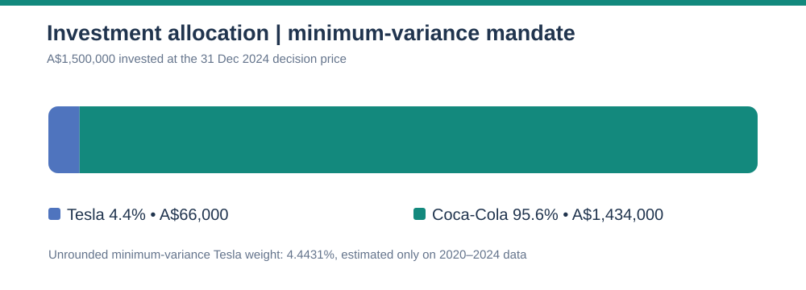
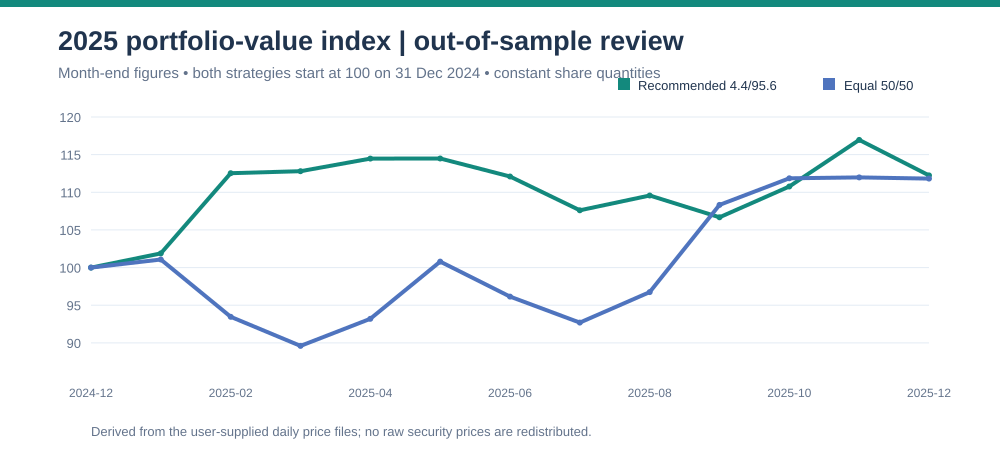
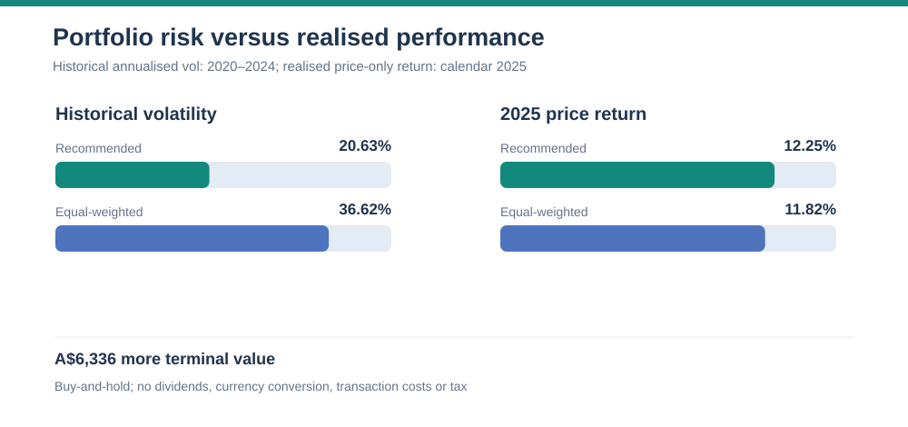

# Assessment 3 | Investment Committee Portfolio Recommendation

**Financial Econometrics · ECON1195 · RMIT University · Individual study**  
**Securities:** Tesla (TSLA) and Coca-Cola (KO) · **Decision:** 31 December 2024 · **Evaluation:** calendar 2025

[← Subject portfolio](../README.md) · [Methodology](docs/methodology.md) · [Data and model audit](docs/model-audit-and-limitations.md)

> **Portfolio presentation of already-completed coursework.** This README, charts, and verification code are a **post-submission AI-assisted presentation**, not original materials submitted to RMIT. The assignment explicitly restricted AI use to debugging R code, so this portfolio reconstruction must not be represented as coursework produced without outside assistance. Original reports, lecture materials, videos, R workspaces and raw market-price exports are excluded.

## The decision in 30 seconds

The client had an **A$1.5m investment mandate** restricted to two US-listed shares. The research question was which two-stock allocation minimised estimated return variance using information available **no later than 31 December 2024**, and how it compared with 50/50 buy-and-hold when evaluated during 2025.

| | **Recommended** | **Equal weight** |
|---|---:|---:|
| Tesla allocation | **4.4%** (A$66,000) | 50.0% (A$750,000) |
| Coca-Cola allocation | **95.6%** (A$1,434,000) | 50.0% (A$750,000) |
| Historical annualised volatility | **20.63%** | 36.62% |
| **Verified 2025 buy-and-hold price return** | **12.25%** | 11.82% |
| **Verified final portfolio value** | **A$1,683,696** | A$1,677,361 |
| Verified realised 2025 annualised volatility | 16.87% | 27.07% |
| Verified maximum drawdown | -8.99% | -20.11% |

**Decision:** The proposed **4.4% TSLA / 95.6% KO** allocation reduced historical portfolio variance and subsequently experienced less volatility and smaller drawdown than a 50/50 mix. Its verified 2025 final value exceeded equal weighting by **A$6,336**. This is one historical year of price-only results, not proof of future outperformance.

## Investment performance, 2025

The figure uses **month-end portfolio values indexed to 100** (not a redistributed security price history), with shares held constant from 31 December 2024. Each strategy begins at the same A$1.5 million value.

## Econometric framework

- **Return construction:** 1,258 matched closing-price dates over 2020–2024 produce **1,257 daily log returns** for each stock. No 2025 data are used for the allocation or fitting the original models.
- **Conditional mean:** The primary report adopts Tesla **ARIMA(0,0,0)** and Coca-Cola **ARIMA(5,0,4)**, while an alternate uploaded report retains Coca-Cola **ARIMA(6,0,2)**. This difference affects one-day mean forecasts and subsequent model-based VaR.
- **Volatility:** Reported model choices are Tesla **GARCH(1,1)** and Coca-Cola **GJR-GARCH(1,1)**. These were **not independently refitted in native R** for this GitHub package.
- **Portfolio weights:** The unconstrained two-asset minimum-variance solution is **4.443% Tesla**, which satisfies the long-only constraint; the implemented weight is rounded to 4.4%.
- **VAR & Granger causality:** Reported VAR(1) tests do not find directional significance; VAR(9) reports Tesla → Coca-Cola at p≈0.027, but residual diagnostics are inadequate. Treat this as **specification-sensitive predictive evidence, not causal proof**.
- **Conditional one-day VaR:** The primary submitted report quotes **A$20,533** for the recommendation versus **A$53,001** for equal weighting at 95%. Other uploaded versions quote different estimates. **These are reported model outputs, not independently verified native R values.** See [audit](docs/model-audit-and-limitations.md).

## Technical methods and files

| Resource | Purpose |
|---|---|
| [Local-data README](data/README.md) | Data prerequisites, windows and access restrictions |
| [Portfolio R analysis](scripts/verify_portfolio.R) | Clear, date-aligned R calculation of portfolio allocation and 2025 price-only performance |
| [Python verification module](src/portfolio.py) | Independent, standard-library implementation for audit and tests |
| [Python CLI](scripts/verify_portfolio.py) | Run an independent audit on your locally stored inputs |
| [Verified aggregates](results/verified_portfolio_summary.json) | Results independently checked from supplied price files |
| [Reported-model variants](results/model_variants_reported.csv) | Explicit disclosure of conflicts between submitted documents |
| [Detailed methodology](docs/methodology.md) | Minimum variance, VaR, VAR and performance definitions |
| [Model audit and limitations](docs/model-audit-and-limitations.md) | Unverified R models, model selection and data restrictions |

### Reproduce the verified price-only results

1. Obtain permitted local copies of the **four price CSVs** and place them under `assessment-3-portfolio-investment-analysis/data/private/` using filenames in [data/README.md](data/README.md).
2. From the repository root: `python assessment-3-portfolio-investment-analysis/scripts/verify_portfolio.py`. This requires **Python 3.10+ only**, with no third-party packages.
3. Or run the companion R script with **R 4.x**: `Rscript assessment-3-portfolio-investment-analysis/scripts/verify_portfolio.R`. This also requires no third-party packages.
4. Run built-in aggregate unit tests: `python -m unittest discover -s tests -v`. Tests cover derived output consistency and synthetic formula edge cases; running them alone does **not** re-estimate GARCH/VAR models.

## Research integrity and scope

**This is a historical analytical case, not an actual client mandate.** Original documentation describes an A$1.5m allocation to USD-listed stocks but does not model foreign-exchange conversion; therefore the reported monetary portfolio figures are **illustrative constant-currency equivalents**, not realised FX-adjusted Australian-dollar returns. Cash dividends, brokerage, tax, corporate-action and execution frictions are excluded. The 2025 outcome is a *price-only backtest*. The original brief requested the same two companies as Assessments 1 and 2, although Assessment 1 actually used **Tesla/NVIDIA**: the security substitution is disclosed.

For an institutional audience, the central skill demonstrated is **disciplined information cut-offs, covariance-based risk allocation, explicit uncertainty and out-of-sample checking**, rather than a claim to have predicted stock performance.

*No endorsement from RMIT, Investing.com, Tesla or Coca-Cola. Not investment advice.*
